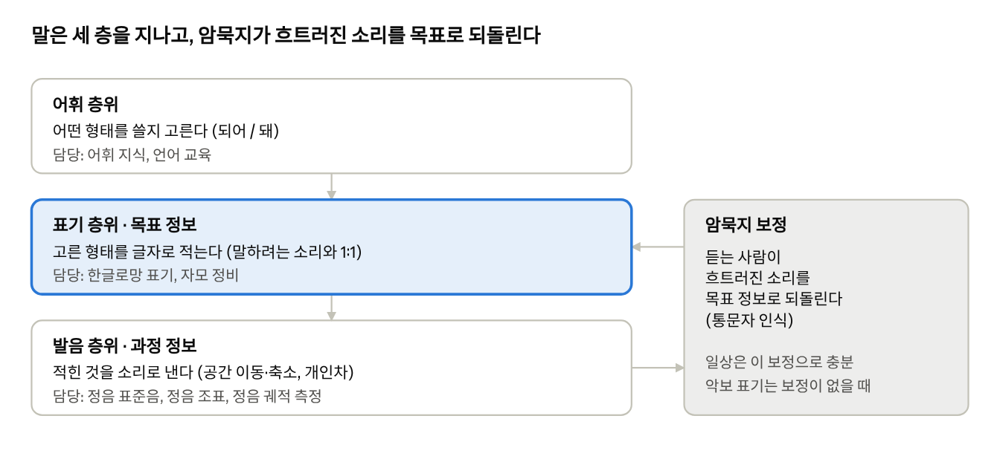
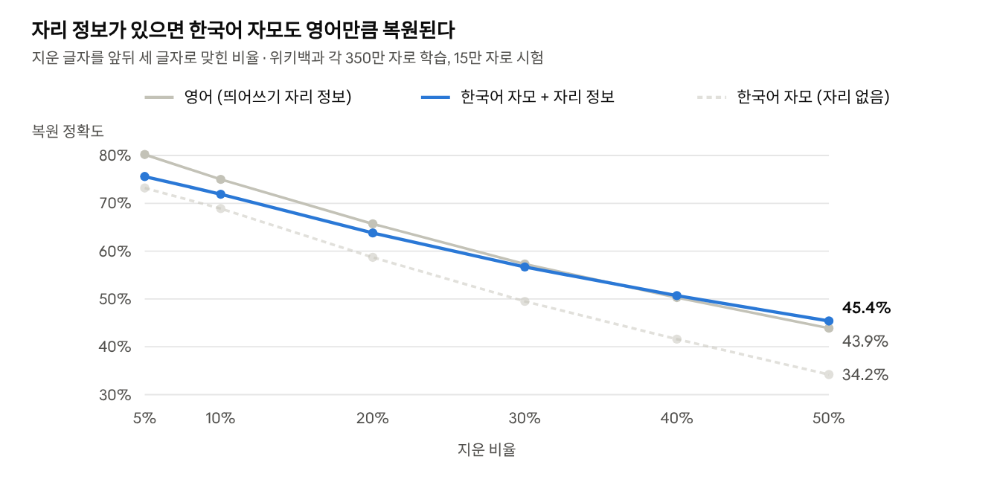
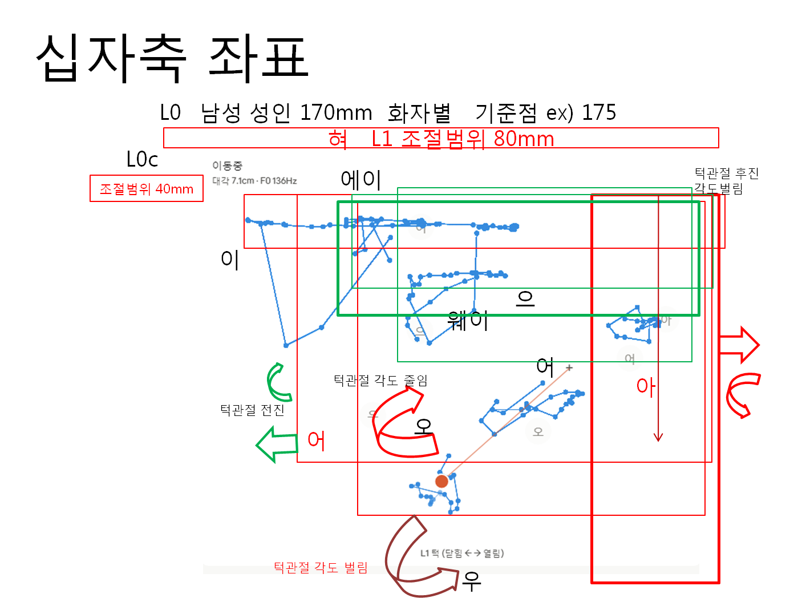
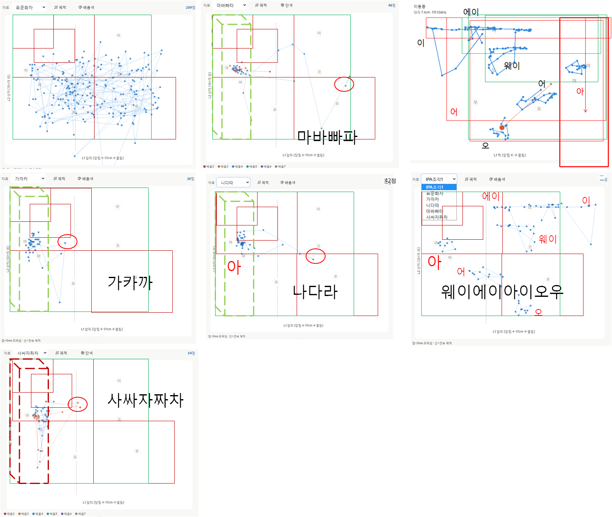

# 한글로망 언어정보 연구 정리

Oct 31, 2026 · @한글로망

## 요약

한글로망 연구는 훈민정음의 소리-글자 대응 원리를 국제 표기, 좌표 주소,
음성 분석에 적용하는 개인 연구다. 성과는 다섯 가지 산출물과 하나의 이론
틀로 정리된다.

| 산출물                  | 무엇을 푸는가                              | 현재 상태                   |
|-------------------------|--------------------------------------------|-----------------------------|
| 한글로망 표기 (Texture) | 로마자에서 한글로 되돌릴 수 없는 현행 표기 | 변환기 구현, 완전 가역      |
| Glo100 좌표 주소        | 길고 외우기 어려운 좌표                    | 변환기 구현, 확인 음절 포함 |
| 정음 도량형 표기        | 복잡한 단위·접두어 체계                    | 기본 구상, 변환기 구현      |
| 정음 궤적 추적기        | 소리를 조음 공간으로 재는 도구             | 개인 연구용 시운전 단계     |
| 정음 조표               | 강세·장단·약화의 표기                      | 기호 시안 단계              |

이론 틀은 "음성은 공간 기반 상대 정보"라는 관점과, 말이 어휘·표기·발음
세 층을 지난다는 계층 모형이다. 발표 순서는 검증할 수 있는 체계 분석이
먼저이고, 기원 가설(목은 이색)은 마지막이다.

## 연구 배경

연구는 2012년, 현행 국어 로마자 표기법이 한글 철자와 소리를 왜곡한다는
문제에서 시작했다. 현행 표기는 발음을 옮기는 전사 방식이라, '독립문'이
Dongnimmun이 되고 로마자에서 한글로 되돌릴 수 없다.

표기 문제를 풀려고 한글로망 글꼴과 자동 변환을 만들었고, 그 과정에서
자모 규칙과 표준발음법의 무리한 부분까지 정비했다. 이 작업이 소리 자체의
체계(5성 기관, 천지인 위상) 연구로 이어졌다.

연구자는 산업공학, 인간공학, 정보 표준화, 데이터 마이닝, 정보보안
분야에서 일해 왔다. 조직과 연구 자금 없이 14년간 연구와 사업화를
병행했고, 현재 후속 특허 6건을 출원한 뒤 전략 방향을 검토하고 있다.

## 핵심 관점: 음성은 공간 기반 상대 정보

말소리는 조음 기관이 만드는 공간의 위치로 정의되고, 절대값이 아니라 화자
자신의 기준에 대한 상대값으로 인지된다.

- **모음:** 천지인 2차원 십자 공간의 위상으로 식별된다. '으'가 중심이고
  '오'는 위, '우'는 아래, '어'·'이'는 왼쪽, '아'는 오른쪽이다.

- **자음:** 5성 기관(아·설·순·치·후)이 만들며, 두 경로로 정보를 전한다.

  - 소음 경로: 파열·마찰의 고주파 성분

  - 배음 변조 경로: 모음 배음 위상의 교란(용음 ㄴㅁㄹㅇ, 모음으로의
    전이)

- **가획:** 기본자(공명음)는 조음 위치를, 획이 더해질수록 고주파
  에너지가 커지는 단계를 나타낸다(ㄴ→ㄷ→ㅌ, ㅁ→ㅂ→ㅍ, ㅅ→ㅈ→ㅊ,
  ㅇ→ㆆ→ㅎ).

- **공간 이동과 축소:** 빠르거나 편한 발화에서는 혀가 목표 위치에 못
  미친다. 또박또박 발음하면 이론값에 가까워진다.

**코러스 공간:** 또박또박 말할 때의 천지인 십자는 기준틀이다. 대화
속에서는 모음조화, 접변, 구개음화 등으로 공간이 옮겨 가고 줄어들며 L1이
크게 이동하지만, 십자 틀도 함께 옮겨 가므로 틀 안의 상대 위치는
유지된다. 그래서 공간 이동 환경에서도 정음 십자 기준의 소리 식별은
명확히 유지된다. IPA는 옮겨 간 실제 소리를 다른 기호로 적지만, 정음은 틀
안의 상대 위치를 적으므로 같은 글자로 남는다.

| 한글로망 관점       | 가까운 현대 이론                          | 차별점                               |
|---------------------|-------------------------------------------|--------------------------------------|
| 모음의 천지인 위상  | 포먼트(F1·F2) 모음 공간                   | 문자 모양과 공간 좌표를 직접 연결    |
| 자음의 배음 변조    | 포먼트 전이, 로커스 이론(해스킨스 연구소) | 가획 체계와 한 모형으로 묶음         |
| 상대 정보           | 화자 정규화(Lobanov 등)                   | 화자의 쉬는 자리를 기준으로 잠       |
| 공간 축소, 또박또박 | 조음 미달, Lindblom의 H&H 이론            | 축소를 십자 중심('으') 방향으로 측정 |

## 계층 정보 모형

한글 표기는 발화된 소리가 아니라 말하는 사람이 의도한 소리(목표 정보)와
1:1로 대응한다. 실제 발화의 변이(과정 정보)는 암묵지가 바로잡으므로
인지적으로는 1:1로 느껴진다.

계층 정보 모형 · 세 층과 암묵지 보정

'값이'는 \[갑씨\]로 소리 나지만, 화자는 이를 국어 시간에야 인식한다.
화자가 표면형이 아니라 기저형을 인지한다는 생각은 사피어(1933)의 '음소의
심리적 실재'와 이어진다.

**읽기 절차 (이중 경로):** 사람은 아는 단어를 통째로 알아보고(어휘
경로), 처음 보는 단어는 글자를 소리로 조립한다(낱자 경로).

| 처음 보는 단어 | 영어 (Piccadilly)                      | 한글 (피카디리)                        |
|----------------|----------------------------------------|----------------------------------------|
| 낱자 경로      | 믿을 수 없음 (cc, ll, y의 소리 미확정) | 믿을 수 있음 (음절 경계와 자모가 보임) |
| 필요한 것      | 짐작, 사전 발음기호, 음성 듣기         | 글자만                                 |
| 단계           | 5단계                                  | 1단계                                  |

영어는 철자 깊이(orthographic depth)가 가장 깊은 언어로 꼽힌다. Seymour
등(2003)의 유럽 13개 언어 비교에서, 초등 1학년 말 쉬운 단어 정확도는
핀란드어 등이 90% 이상, 영어는 약 34%였다. 한글 출석부에서는 이름을 잘못
부르는 일이 거의 보고되지 않는다.

**듣기와 쓰기의 비대칭:** 듣기·읽기에서는 문맥과 통문자가 변이를
바로잡는다. 쓰기에서는 철자를 직접 골라야 해서 오류가 드러나지만, 이는
교육의 허점이고 현장에서는 문제없이 처리된다.

### 계층별 비교 기준

언어나 문자를 비교할 때는 같은 층위끼리, 같은 기준으로 비교해야 한다.
비판할 때도 같은 균등성을 지킨다. "AI가 한글만 99% 정확하다" 같은 주장은
아래 기준이 빠지면 의미가 없다.

| 기준            | 질문                                   | 예                                                         |
|-----------------|----------------------------------------|------------------------------------------------------------|
| 출발 층위       | 무엇에서 시작하는가                    | 발화된 소리, 손글씨 이미지, 입력된 문자                    |
| 도착 층위       | 무엇을 맞히는가                        | 글자, 단어, 문장, 의도·개념                                |
| 측정 단위       | 무엇을 하나로 세는가                   | 글자 오류율(한국어에 흔히 씀), 단어 오류율(영어에 흔히 씀) |
| 자료 조건       | 같은 조건인가                          | 낭독, 일상 대화, 잡음, 사투리                              |
| **암묵지 부하** | 사람이 추가로 짊어지는 부담은 얼마인가 | 예외 철자 암기, 발음기호 참조, 발음 규칙 역변환            |

표기·발음 층위에서 비교하면 영어의 소리-철자 어긋남이 훨씬 크다. 영어는
발음기호라는 보조 체계를 두고도 사전 없이 새 단어를 읽기 어렵고,
한국어는 몇 가지 발음 규칙(예: '값이' → \[갑씨\])만 익히면 된다.

**암묵지 부하와 난독:** Paulesu 등(2001, Science)은
영어·프랑스어·이탈리아어 사용자 가운데 난독증이 있는 사람들의 뇌를
비교했다. 뇌의 차이는 세 언어에서 같았지만, 철자가 투명한
이탈리아어에서는 읽기 장애가 훨씬 가볍게 나타났다. 표기 층위가
불투명하면 그 부담이 사람의 암묵지로 넘어가고, 감당하지 못하는
사람에게는 난독으로 나타나며, 위 층위(독해, 의미 이해)까지 막힌다. 한
층위의 문제가 전체 구조를 무너뜨린다.

### 의미 층위: 감각어의 음양 원리

의미 층위에서는 어느 언어가 전체적으로 더 정밀한가보다, 어떤 영역이
정밀한가를 비교한다. 색깔·감각·감정의 정도와 결을 나타내는 영역에서는
한국어가 뛰어나다. 그 정밀성은 단어 목록이 아니라 규칙에서 나온다.

| 원리                      | 예                           | 더해지는 의미             |
|---------------------------|------------------------------|---------------------------|
| 모음 바꾸기 (양성 ↔ 음성) | 노랗다 ↔ 누렇다, 졸졸 ↔ 줄줄 | 밝고 가벼움 ↔ 어둡고 짙음 |
| 자음 바꾸기               | 빙빙 → 핑핑 → 뻙뻙           | 세기                      |
| 접미사 붙이기             | 노르스름하다, 누리끼리하다   | 옇음, 탁함                |
| 반복                      | 노릇노릇, 푸릇푸릇           | 여기저기 고르게           |

영어는 색을 세밀하게 나타낼 때 대개 다른 단어를 빌려 오거나 구절을
덧붙인다(bluish, navy, azure). 한국어는 하나의 단어 안에서 규칙으로
정도와 결을 조절하므로, 처음 듣는 표현도 화자가 바로 알아듣는다.

노랗다(ㅏ)와 누렇다(ㅜ)의 대비는 훈민정음 제자해의 양성·음성, 곧 음양
구분 그대로다. Glo100이 모음을 음양 대비 쌍으로 고른 것도 같은 원리다.
정음의 음양 원리는 소리의 구별(Glo100)과 의미의 정밀화(감각어)에 똑같이
작동한다.

한자어는 동양 철학의 개념 체계를 담은 조합 층이다(예: 온도, 온기, 온화,
보온). 영어에는 라틴어·그리스어 어근이 같은 역할을 한다(thermo-, -meter,
-logy).

## 한글로망 표기 체계

한글로망은 글자 하나에 소리 하나를 대응시켜, 로마자로 적어도 한글로
완전히 되돌릴 수 있는 표기다. 한글은 적힌 대로 읽히는데, 현행 국제
표기는 로마자로 옮기는 과정에서 이 강점을 잃는다.

**왜곡의 사례:** 같은 성씨가 여러 표기로 흩어진다. 이(Lee, Yi, Rhee),
박(Park, Pak, Bak), 최(Choi, Choe), 정(Jung, Jeong, Chung). 이것은
한글의 결함이 아니라 로마자로 옮기는 과정의 왜곡이다.

**기본 대응:** 자음 G N D R M B S X J C K T P H(ㅇ은 X), 기본 모음 a e o
u w y(ㅡ는 w, ㅣ는 y). Texture는 완전 가역이고, X 간략화는 철자 앞
ㅇ(X)을 생략해 더 짧다.

**자모 정비:** 맞춤법 오류가 몰리는 곳은 소리는 합쳐졌는데 글자는 구별을
유지하는 겹모음이다. 한글로망은 그 겹모음을 천지인 조합 구조대로 풀어
적는다.

| 자주 틀리는 곳 | 현대 발음              | 한글로망 표기  | 드러나는 구조                 |
|----------------|------------------------|----------------|-------------------------------|
| 내 / 네        | 거의 같음              | ay / ey        | ㅏ+ㅣ, ㅓ+ㅣ                  |
| 외 / 왜 / 웨   | 거의 같음 \[we\]       | oy / oay / uey | ㅗ+ㅣ, ㅗ+ㅐ, ㅜ+ㅔ           |
| 의             | \[의\], \[이\], \[에\] | wy             | ㅡ+ㅣ                         |
| 얘 / 예        | 거의 같음              | yay / yey      | 이 선행 + 기본 모음 + 이 후행 |
| 와 / 워        | 구별됨                 | oa / ue        | ㅗ+ㅏ, ㅜ+ㅓ                  |

**범위:** '되어 → 돼' 같은 축약은 모든 언어에 있는 경제성 현상이고 어휘
층위의 문제다. 한글로망은 형태가 정해진 뒤의 표기·발음 층위를 다룬다.

**비교 대상:** 국어 로마자 표기법 제3장 제8항(한글 복원을 전제로 한 철자
표기), 예일 표기법도 가역적이다. 차별점은 짧은 길이, 규칙만 익히면
누구나 같은 소리로 읽는다는 점, 모아쓰기 글꼴이다.

## Glo100 좌표 주소

Glo100은 음절 하나가 위도 한 자리와 경도 한 자리를 나타내는 한글100진법
주소다. 지구 어디든 구역 숫자와 7음절로 약 1m까지 말할 수 있다.
([변환기](../tools/glo100.html))

**구조:** 자음 10개(ㅇㄱㄴㄷㄹㅁㅂㅅㅈㅊ = 0~9)는 위도 자리, 모음
10개(ㅡㅏㅓㅗㅜㅣㅑㅕㅛㅠ = 0~9)는 경도 자리다. 한 음절 내려갈 때마다
칸이 10분의 1로 줄어, 1음절 약 1,111km에서 7음절 약 1.1m가 된다.

| 예             | 좌표                    | Glo100             |
|----------------|-------------------------|--------------------|
| 인천 계산동    | 37.5390208, 126.7236864 | 2 도샤.며더초야/뎴 |
| 롬복 길리 인다 | −8.36064, 116.03900     | 6 어쟈.드보유브르  |

**음절 선정 원리:** 자음은 훈민정음 5성 기관의 표준음 순서로 놓았다.
모음은 음양이 뚜렷한 대비 쌍(ㅏ/ㅓ, ㅗ/ㅜ, ㅑ/ㅕ, ㅛ/ㅠ, ㅡ/ㅣ)으로 골라
조음점 대칭으로 혼동을 막는다. 같은 기관의 이웃 자음(ㄷ/ㄹ, ㅈ/ㅊ)은
숫자도 하나 차이라 잘못 들어도 오차가 작다.

**오류 보호 두 가지:**

- **음성 호출:** 음절마다 숫자를 붙여 부른다(도33 샤76 며57). 같은
  정보를 두 번 전해 듣는 사람이 바로잡는다.

- **확인 음절:** 끝에 한 음절을 붙인다. 자음은 위도 자리들로, 모음은
  경도 자리들로 Damm 검사 숫자를 계산한다. 시험한 599가지 오류(음절
  바꾸기 594, 이웃 순서 바꾸기 5)를 모두 잡았다.

| 체계         | 쓰는 곳            | 약 1~10m를 말하는 길이      | 사람이 도구 없이 좌표로 바꿀 수 있나 |
|--------------|--------------------|-----------------------------|--------------------------------------|
| Glo100       | 제안               | 구역 + 7음절 (약 1m)        | 예: 100칸 표만 알면 됨               |
| MGRS         | 한국군 포함 NATO   | 약 15자 (1m)                | 예                                   |
| Plus Codes   | Google 지도        | 11자 (약 3m)                | 아니오                               |
| what3words   | 일부 물류·긴급구조 | 단어 3개 (3m)               | 아니오                               |
| 국가지점번호 | 국내 산악·해안     | 한글 2자 + 숫자 8자리 (10m) | 예                                   |

**구역 숫자:** 북반구는 서경 180–90° = 4, 서경 90–0° = 3, 동경 0–90° =
1, 동경 90–180° = 2이고, 남반구는 8, 7, 5, 6이다. 한국(2)과 롬복(6)은
예시로 확인했고, 나머지는 그림 자료에서 추정한 것이다.

**설명 논리:** 자연 언어는 문맥과 통문자가 오류를 바로잡지만, 주소와
좌표에는 문맥이 없다. Glo100은 잉여성을 모두 덜어 가장 짧게 만들고,
필요한 만큼만 숫자와 확인 음절로 되돌려 넣었다.

## 정음 조표

정음 조표는 정음 궤적으로 잰 값을 악보처럼 적는 보조 표기다. 사람이
소리에 얹는 동작은 몇 개 안 되므로 기호도 몇 개면 충분하다.

| 기호 | 동작          | 예                          | 측정값                                |
|------|---------------|-----------------------------|---------------------------------------|
| ^    | 높게, 강세    | 중국어 1성, 영어 강세       | 음높이(P0c)가 마디 조표보다 높음      |
| /    | 오르며        | 중국어 2성                  | 음절 안 음높이 기울기                 |
| /    | 내렸다 오르며 | 중국어 3성                  | 음절 안 음높이 기울기                 |
| \\   | 내리며        | 중국어 4성                  | 음절 안 음높이 기울기                 |
| :    | 길게          | 영어 강세 음절, 한국어 장음 | 음절 길이가 마디 평균보다 김          |
| \_   | 약하게 뭉갬   | 영어 약모음 \[ə\]           | 세기가 약하고 모음이 '으' 쪽으로 수축 |

예: Piccadilly → 피^:커:딜 리. 원본 시안은 약화를 띄어쓰기로 적었다.
띄어쓰기는 단어 경계와 겹치므로 별도 기호(\_)가 기계 처리에 안전하다.

**약화의 연속선:** 온전한 모음 → 약화(\_으, '으'의 전설성마저 흐려져
\[ə\]에 가까움) → 거의 소리 없음(성대 진동이 끊기고 자음만 남음). 측정상
뭉개기는 모음 궤적이 십자 중심('으')으로 수축하는 현상, 곧 공간 축소다.

**외래어 '으' 삽입:** strike는 1음절인데 '스트라이크'는 5음절이다. 거의
소리 없는 '으'를 표시하면 한글 표기를 바꾸지 않고도 자음군을 영어에
가깝게 읽게 할 수 있다. 거의 소리 없음에 쓸 기호는 아직 정하지 않았다.

**일상 표기와 분리:** 일상은 암묵지로 해결하고, 악보 표기는 필요한
곳에서만 쓴다. 필요한 곳은 외국어 교육, 발음 교정, 음성 합성(기계에는
암묵지가 없음), 연구 기록이다. 기본층(한글)은 그대로 두고 보조층(기호)만
얹는다.

## 정음 조표 표기 규칙 초안 (v0.1)

정음 조표는 정음 궤적의 측정값에서 기호가 자동으로 나오도록 규칙을
정한다. 사람이 듣고 판단해 기호를 붙이는 ToBI·K-ToBI와 달리, 마디 안에서
재 상대값이 문턱을 넘으면 기호가 붙는다. 아래의 문턱은 모두 초안이며
사례로 다시 정한다.

### 원칙

1.  **기본층과 보조층 분리:** 한글 표기는 그대로 두고, 조표 기호만
    덧붙인다. 기호를 지우면 일상 표기가 된다.

2.  **마디 상대값:** 기준은 절대값이 아니라 그 마디의 조표다(코러스
    공간). 화자가 바뀌어도 같은 기호가 나온다.

3.  **기호 하나에 측정 하나:** 기호마다 판정하는 측정값과 문턱을 하나씩
    정한다.

4.  **판정 순서 준수:** 표준 화자 판정 매뉴얼처럼 쉽고 확실한 특징부터
    짚는다.

5.  **자판 기호:** 일반 자판에 있는 기호만 쓴다.

### 마디 조표의 정의

마디는 무음으로 끊기는 소리 묶음이다(추적기의 "마디 끊김 기준"). 마디
조표는 그 마디 안에서 재는 다섯 값이다.

| 조표 항목   | 계산                                      |
|-------------|-------------------------------------------|
| 기준 음높이 | 마디 안 유성 프레임의 음높이(F0) 중앙값   |
| 기준 길이   | 마디 안 음절들의 모음 유지 구간 중앙값    |
| 기준 세기   | 마디 안 모음 피크 세기의 중앙값           |
| 공간 틀     | 마디 안 모음들의 L1·L2 범위 (코러스 공간) |
| 공간 중심   | 마디의 '으' 자리 또는 화자의 쉬는 자리    |

### 기호표

| 기호 | 자리    | 뜻             | 측정값                      | 문턱 (초안)                                                                          | 예                                  |
|------|---------|----------------|-----------------------------|--------------------------------------------------------------------------------------|-------------------------------------|
| ^    | 음절 뒤 | 높게, 강세     | 음절 최고 음높이            | 기준 음높이보다 반음 2개 이상 높음, 또는 세기 +3dB 이상                              | 피^                                 |
| /    | 음절 뒤 | 오르며         | 유지 구간의 음높이 변화     | 시작→끝 반음 2개 이상 상승                                                           | 마/ (중국어 2성)                    |
| \\   | 음절 뒤 | 내리며         | 유지 구간의 음높이 변화     | 시작→끝 반음 2개 이상 하강                                                           | 마\\ (4성)                          |
| \\   | 음절 뒤 | 내렸다 오르며  | 유지 구간의 최저점          | 최저점이 가운데 1/3에 있고, 양쪽과의 차가 반음 1.5개 이상                            | 마\\ (3성)                          |
| :    | 음절 뒤 | 길게           | 모음 유지 구간 길이         | 기준 길이의 1.5배 이상 (긴 소리는 거의 두 소리라 목표 약 2배)                        | 눈:\[누운\] 말:\[마알\] 선:\[서언\] |
| \_   | 음절 앞 | 약하게 뭉갬    | 세기와 공간 중심까지의 거리 | 세기 −6dB 이하, 그리고 모음이 공간 중심('으') 쪽으로 공간 틀 반지름의 절반 이상 수축 | \_리                                |
| '    | 음절 뒤 | 거의 소리 없음 | 성대 울림과 유지 길이       | F0 없음(무성화), 또는 모음 유지 30ms 미만                                            | 스'트'라이크'                       |

여러 기호가 붙을 때는 높이(^) → 움직임(/ \\ \\) → 길이(:) 순서로 적는다.
예: 피^:커:딜 \_리. 약화(\_)는 연구자의 원래 표기(\_으)대로 음절 앞에
붙인다.

### 판정 순서

1.  **마디 나누기:** 무음이 기준 시간 이상 이어지면 마디를 끊는다.

2.  **마디 조표 계산:** 위의 다섯 값.

3.  **음절 나누기:** 음절 안의 시간 단계 0~9(묵음, 자음 시작, 자음, 모음
    진입, 모음 피크, 모음 유지, 모음 하강, 받침 진입, 받침 완성, 경계
    종결)로 나눈다.

4.  **자음 순간 제외:** 판정 매뉴얼의 앞 단계(고주파, ZCR, 에너지
    급변)로 자음 프레임을 걸러 낸다. 조표 판정은 모음 구간(단계 3~6)만
    쓴다.

5.  **무성화 '**: 모음 구간에 F0가 없거나 30ms보다 짧으면 '를 붙이고
    아래 판정을 건너뛴다.

6.  **길이 :**: 유지 구간을 기준 길이와 비교한다.

7.  **높이와 움직임 ^ / \\ \\**: 유지 구간의 음높이 최고값과 변화를 기준
    음높이와 비교한다.

8.  **약화 \_**: 세기와 공간 중심까지의 거리를 본다.

9.  **이중모음:** 출발 부분은 유지가 없는 이동이므로 길이·높이 판정은
    도착 소리의 유지 구간으로 한다.

### 복모음 판정: 표기대로 소리 나는 결합

한국어 복모음은 표기대로 소리 난다. 출발 소리가 곧 목표 소리이지만 머물
수 없고, 유지는 도착 소리에서 일어난다. '요'를 길게 내면 '요오', '유'는
'유우'가 된다. 출발이 짧아 변이처럼 보일 뿐이다.

글자도 같은 원리로 결합한다(ㅣ+ㅏ → ㅑ, ㅗ+ㅏ → ㅘ). 영어에도
\[j\]·\[w\]로 시작하는 소리(yes, we)는 있지만 자음과 모음으로 따로 적고,
모음 글자를 규칙적으로 합쳐 적는 체계는 없다. 영어를 대표하는
이중모음(ace \[eɪ\], ice \[aɪ\])은 중심 모음이 먼저 유지되고 끝에서
미끄러지는 반대 구조다. 연구자는 이 결합 기술을 한국어의 특장점으로
보며, 복모음을 영어식 이중모음과 같은 현상으로 보는 논의 속에서 이
특장점이 가려졌다고 본다.

| 유형                                  | 유지 구간의 위치             | 출발 이동                        | 판정                      | 표기                                      |
|---------------------------------------|------------------------------|----------------------------------|---------------------------|-------------------------------------------|
| 정음 복모음 (상승형)                  | 모음 구간의 뒤쪽 (도착 소리) | 짧음: 모음 구간 앞 30% 안 (초안) | 표기대로 난 복모음        | 한글 그대로                               |
| 두 모음 현상 (영어·중국어의 이중모음) | 모음 구간의 앞쪽 (출발 소리) | 끝에서 미끄러짐                  | 두 모음이 이어진 소리     | 두 모음으로 적음 (ice → 아이, ace → 에이) |
| 두 음절로 나뉠                        | 출발과 도착 모두 유지        | 길게 끌림                        | 복모음이 아님 (예: 이-아) | 두 음절로 적음                            |
| 출발 생략                             | 도착만 있음                  | 없음                             | 축약 (예: 의 → \[이\])    | 발음 규칙에 따름                          |

한국어 복모음은 규칙적인 음운현상을 수반하므로 따로 표기할 이유가 없다.
영어와 중국어의 이중모음은 이와 전혀 다른 음운현상인 두 모음 현상이다.
중국어 병음이 ai, ao, ei, ou처럼 두 모음을 한 덩어리로 적는 것도
이중모음으로 이어 읽으라는 신호다. 그래서 정음으로 적을 때는 별도 기호
없이 두 모음으로 적는다(아이, 아오, 에이, 오우). 학습자 판정에서도
한국어 복모음을 두 모음 현상처럼 낸 경우를 이 유형으로 분류한다.

**접기와 펼치기:** 장음은 같은 모음이 두 번 이어지는 거의 두 소리(눈:
\[누운\], 말: \[마알\])인데, 규칙적이라 한 음절로 접어 적는다. 한국어
복모음도 규칙적인 음운현상을 수반하므로 한 음절로 적는다. 반면
영어·중국어의 이중모음은 한국어 규칙으로 복원되지 않는 두 모음 현상이라
두 모음으로 펼쳐 적는다. 정음은 규칙으로 복원되는 것은 접고, 복원되지
않는 것은 펼친다. 조표 기호(:)는 접힌 것을 악보 표기에서 다시 드러내야
할 때만 쓴다.

길이(:)와 높이(^ / \\ \\) 판정은 복모음의 유지 구간, 곧 도착 소리에서
한다. 훈련 교재 제5과가 이 규칙을 연습하는 과정이다.

### 검증 절차

1.  사례 녹음에 사람이 듣고 기호를 붙인다(두 사람 이상이면 더 좋다).

2.  같은 녹음에 추적기가 위 규칙으로 기호를 계산한다.

3.  기호별 일치율을 잰다. 일치하지 않는 사례를 모아 문턱을 고친다.

4.  화자 집단(성별, 나이, 지역, 모어)별로 문턱이 달라야 하는지 본다.

### 아직 정하지 않은 것

- **느낌(발성의 결):** 숨 섞인 소리, 눌린 소리 등. 추적기의 ΔH1−H2로 잴
  수 있으나 기호와 문턱이 없다.

- **화성(배음 구조):** 배음 측정을 기호로 요약하는 방식이 없다.

- **이동 조건:** 이중모음·천이의 속도나 경로 이탈을 기호로 적을지 정해야
  한다.

- **다른 체계와의 기호 충돌:** Glo100은 '.'과 '/'(확인 음절)를 쓴다. 한
  문서에서 함께 쓸 때의 구분 규칙이 필요하다.

## 정음 도량형 표기

SI 단위를 음절 하나로 적는다. 초성은 단위, 중성은 차원, 종성은
접두어(크기)이고, 받침에 ㄹ이 붙으면 역수다. ([정음 단위
변환기](../tools/jeongeum-units.html))

| 차원            | 기본 음절  | 로마자       | 예                       |
|-----------------|------------|--------------|--------------------------|
| 질량 (g)        | 기         | gy           | 깈 kg, 김 톤(Mg), 긹 mg  |
| 길이 (m)        | 미         | my           | 밐 km, 및 cm, 밁 mm      |
| 넓이 (m²)       | 머         | me           | 먐 km²                   |
| 부피 (m³)       | 무         | mu           | 묻 리터(dm³), 뭋 cc(cm³) |
| 속력 (m/s, m/h) | 미초, 미시 | my·co, my·sy | 밐시 km/h                |

| 접두어       | 배수 | 받침 | 로마자 |
|--------------|------|------|--------|
| 메가 (M)     | 10⁶  | ㅁ   | m      |
| 킬로 (k)     | 10³  | ㅋ   | k      |
| 데시 (d)     | 10⁻¹ | ㄷ   | d      |
| 센티 (c)     | 10⁻² | ㅊ   | c      |
| 밀리 (m)     | 10⁻³ | ㄺ   | rg     |
| 마이크로 (μ) | 10⁻⁶ | ㄻ   | rm     |
| 나노 (n)     | 10⁻⁹ | ㄼ   | rb     |

접두어는 거듭제곱하기 전의 길이에 붙는다(SI 규약과 같음). 그래서
먐(km²)은 1,000,000m²이고, 묻(dm³)은 1리터다. 헥토, 데카, 기가 이상,
피코 이하(2022년 추가된 론나·퀘타·론토·퀙토 포함)와
초·암페어·켈빈·몰·칸델라는 아직 정하지 않았다.

**말소리 겹침:** 표준 발음법으로 읽으면 역수를 나타내는 ㄹ이 사라져 큰
단위와 작은 단위가 같은 소리가 된다.

| 짝                | 표준 발음 | 크기 차이 |
|-------------------|-----------|-----------|
| 밐(km) / 밁(mm)   | \[믹\]    | 10⁶배     |
| 밈(Mm) / 밂(μm)   | \[밈\]    | 10¹²배    |
| 김(톤) / 긺(μg)   | \[김\]    | 10¹²배    |
| 믿(dm) / 및(cm)   | \[믿\]    | 10배      |
| 묻(리터) / 뭋(cc) | \[묻\]    | 1,000배   |

로마자(myk / myrg)에는 r이 남아 있어 구별된다. 따라서 "단위 음절의
받침은 모두 소리 내고, 역수의 ㄹ은 반드시 발음한다"는 읽기 규칙을 표준에
함께 넣어야 한다.

**모음 선택의 대안 분석:** 도량형은 숫자에 붙는 보조 정보다. 현 구상은
중립 모음 ㅣ를 기본으로 써서 보조 정보임을 나타낸다. 다른 선택지와의
비교는 아래 기준으로 더 분석해야 한다(초안 판단).

| 대안                              | 일반 어휘와 구별             | 발음 안정성                         | 입력·글꼴 지원         | 차원 확장 여지           |
|-----------------------------------|------------------------------|-------------------------------------|------------------------|--------------------------|
| ㅣ·ㅓ·ㅜ (현 구상)                | 낮음: 미, 기, 무는 흔한 음절 | 높음                                | 완전                   | 모음 21개 안에서 가능    |
| ㅢ 계열                           | 높음: 일반 어휘에 드묾       | 낮음: \[의\]·\[이\]·\[에\]로 흔들림 | 완전                   | 좁음                     |
| ㆍ(아래아) 계열                   | 매우 높음: 현대 어휘에 없음  | 낮음: 현대 발음 없음                | 부족: 옛한글 입력·글꼴 | 좁음                     |
| 음절은 그대로 두고 문맥 표시 추가 | 높음                         | 높음                                | 완전                   | 넓음, 대신 길이가 늘어남 |

**활용:** 이 대응표는 교육과정에서 단위를 단위·차원·크기의 세 요소로
가르치는 기초가 되고, 기존 도량형 문서를 읽을 때도 대조표로 쓸 수 있다.

## 측정 근거

한국어와 영어의 잉여성은 비슷한 수준(60~65%)이고, 글자 하나에 담긴
정보는 한국어 음절이 영어 글자의 약 2.1배다. 한국어와 영어 위키백과에서
각각 400만 글자 분량을 무작위로 뽑아 계산했다.

| 단위               | 글자 종류 | 글자당 정보량 (PPMd 압축) | 잉여성 |
|--------------------|-----------|---------------------------|--------|
| 영어 알파벳        | 27        | 1.83비트                  | 61%    |
| 한국어 자모        | 51        | 1.95비트                  | 66%    |
| 한국어 두벌식 자판 | 34        | 1.91비트                  | 63%    |
| 한국어 음절        | 1,741     | 3.86비트                  | 64%    |

바로 앞 글자 하나만 알아도 불확실성이 한국어 자모는 23%, 영어는 16%
줄었다. 자음-모음-(받침) 음절 구조가 가까운 범위의 규칙을 강하게 만든다.

한국어·영어 위키백과 무작위 표본 · 2026-10-31 계산

한국어 자모는 종류가 영어의 두 배 가까이라 하나를 맞히기가 원래 더
어렵다. 모아쓰기가 보여 주는 자리(초성·중성·종성)를 알면 영어 수준까지
따라붙고, 절반을 지운 심한 손상에서는 약간 앞선다.

**해석의 한계:** 복원 모형은 앞뒤 세 글자만 보는 단순한 방식이다. 사람의
통문자 인식, 문맥 이해, 훈련 수준은 반영하지 못했다. 위키백과 문체 한
가지만 썼고, 한국어 위키백과의 외래어가 예측을 다소 어렵게 했을 수 있다.
같은 뜻을 전할 때의 총정보량은 번역 말뭉치로 따로 재야 한다.

**정음 궤적 추적기:** 녹음에서 F0·F1·F2를 재어 길이(cm = 8500 ÷
주파수)로 바꾸고, 조음 궤적을 그리는 개인 연구용 도구다. 화자 정규화,
마디·조표, 비음·유음 판정을 갖추었다. 공간 이동·축소의 원인 추적과 보정
기술 개발 단계에서 멈췄다.

## 각론: 인지 신호 선택의 기초 연구

표준음(기준점)은 가장 강하고 구분이 명확한 신호다. 그러나 실제 말에서는
연속된 발화, 거리, 화자의 특성 때문에 약화·감쇠·잡음이 생기고, 음운
현상도 혼동을 부른다. 이 장은 사람이 어떤 소리를 골라 쓰는지에 관한 기초
연구를 모아, 정음 구조를 검증할 각론의 출발점으로 삼는다.

### 기준점은 지각에 유리한가

| 연구                                      | 핵심 내용                                                                                                              | 정음 모형과의 연결                                          |
|-------------------------------------------|------------------------------------------------------------------------------------------------------------------------|-------------------------------------------------------------|
| 양자 이론 (Stevens, 1989)                 | 조음이 조금 달라져도 소리가 거의 변하지 않는 안정 영역이 있고, 언어는 그 영역을 골라 쓴다                              | 5성 기관과 천지인을 안정 영역으로 볼 수 있는지 검증할 틀    |
| 분산 이론 (Liljencrants & Lindblom, 1972) | 모음 체계는 모음끼리의 지각적 거리가 최대가 되도록 배치된다                                                            | 천지인 기본 모음이 서로 가장 멀리 떨어진 배치인지 계산 가능 |
| 분산-초점 이론 (Schwartz 외, 1997)        | 포먼트가 모여 또렷한 초점 모음이 선호된다. 모음 3~7개인 언어 체계 342개의 85.6%를 예측                                 | 기준 모음을 초점 모음으로 설명할 근거                       |
| 지각 자석 효과 (Kuhl, 1991)               | 사람은 범주의 원형 주변 소리를 원형 쪽으로 끌어당겨 듣는다. 6개월 아기에게도 나타남 (재현 여부에 대한 반론 있음)       | "학습된 척도로 인지한다"는 명제의 실험적 근거               |
| 기본 모음 (Daniel Jones, 1917)            | IPA는 기준 모음 8개를 정해 두고 실제 모음을 그 기준에서의 어긋남으로 기술한다. "어느 언어의 모음도 아닌 지각의 기준점" | 천지인 기준점과 같은 발상                                   |

### 왜 기준점에서 벗어난 소리를 쓰는가

| 연구                                | 핵심 내용                                                                                                                                    |
|-------------------------------------|----------------------------------------------------------------------------------------------------------------------------------------------|
| 모음 공간의 혼잡 (분산 이론의 예측) | 영어는 단모음이 12개 안팎이라 모두 가장자리에 둘 수 없다. 길이, 이중모음화, 긴장/이완 같은 보조 단서로 구별한다                              |
| H&H 이론 (Lindblom, 1990)           | 변이는 잡음이 아니라 적응의 결과다. 화자는 듣는 사람에게 필요한 만큼만 또렷하게 말한다. 목표는 불변의 표준음이 아니라 충분한 구별 가능성이다 |
| 기능 부담 (Wedel 외, 2013)          | 한국어를 포함한 8개 언어의 합류 56건을 분석했다. 구별하는 단어 쌍이 적은 대립일수록 합쳐진다. 언어는 정보 효율에 따라 구별을 남기거나 버린다 |

### 잡음 속 혼동: 인간공학의 고전

- **Miller & Nicely (1955):** 영어 자음 16개를 잡음과 주파수 왜곡 속에서
  들려주고 혼동 행렬로 정리했다. 유성/무성과 비음 여부는 잘 유지되고,
  조음 위치가 가장 쉽게 혼동되었다. 사람은 이 자질들을 서로 독립적으로
  지각했다. 자질 단위로 설계한 훈민정음의 방식이 지각 구조와 맞고, 잡음
  속에서는 조음 위치(5성 기관) 구분에 보완 장치가 필요하다는 뜻이다.
  Glo100의 음성 호출 숫자와 확인 음절이 그 보완이다.

- **NATO 음성 알파벳 (1952~1956):** 31개국 화자를 대상으로 잡음 속
  알아듣기 시험을 거듭해 단어를 골랐다(예: Nectar와 Victor의 혼동). 세부
  내용은 원 문서 확인이 필요하다.

### 연구자의 관찰

- **훈련이 필요한 소리:** '어'는 내기 어려운 발음이고, 훈련하지 않은
  사람은 '에'나 그 주변 소리로 인지한다. 근육의 강도와 훈련이 필요한
  원칙적 구조이고, 자연 언어에서 드물게 나타나는 특성의 반영이다.

- **강조와 명확성:** 소리 하나를 강하게 전달하려는 행동도 소리의 위치를
  바꾼다.

- **음절 천이:** 정음 궤적에서 유지 모음의 변이가 관측된다. 영어와
  중국어에서는 여러 모음이 이어지는 모음 천이 현상이 보인다.

- **장음:** 선(짧은 소리)과 선:(긴 소리)은 실제로 \[서언\]처럼 다르게
  소리 나지만, 표기는 같은 '선'으로 한다. 규칙적이어서 굳이 표기로
  구분하는 부담을 덜어낸 한국어의 지혜로 본다.

- **측정 범위의 단순화:** 정음 규칙은 사람이 어떤 문장을 구현하려고 어떤
  행동을 했는지 이해하게 해 준다. 소리 구분 기준을 단순화하고 측정
  범위를 구체화하는 효과가 있으며, 정음 궤적 추적에서 많이 관측되고
  예상되는 결과다.

### 코러스 공간: 상대 좌표로 판정하기

사람은 모음을 절대 위치가 아니라, 지금 말하는 공간의 틀 안에서의 상대
위치로 식별한다. Ladefoged & Broadbent(1957, *JASA* 29)는 똑같은 녹음
단어를 앞 문장만 바꿔 들려주었고, 듣는 사람들은 그 단어를 다른 모음으로
알아들었다. 앞 문장에서 화자의 모음 공간을 파악하고 그 틀에 맞춰 판정한
것이다. 연구자의 코러스 공간이 이 현상이며, 정음 궤적 추적기의 "마디
조표로 정규화"가 같은 원리다.

|               | 공간 이동                                   | 합류                        |
|---------------|---------------------------------------------|-----------------------------|
| 무엇이 바뀌나 | 십자 틀 전체가 옮겨 가고 줄어듦             | 틀 안의 두 점이 하나로 겹침 |
| 구별은        | 유지됨 (상대 위치가 그대로)                 | 사라짐                      |
| 예            | 빠른 말, 모음조화·접변·구개음화 환경의 모음 | 많은 화자의 ㅔ/ㅐ           |
| 판정 방법     | 그 마디의 틀로 정규화하면 정음 십자로 식별  | 틀을 바꿔도 구별 안 됨      |

**비율 좌표:** 연구자는 모음 자리를 수평·수직 −100~100의 비율 좌표로
환산해 판정한다. 환산표에서 초록은 실측 공간, 노랑은 같은 값을 확장
비율로 보정해 표시한 것이다.

**검증 방법:** 같은 낱말을 또박또박, 보통 속도, 빠른 대화로 녹음한다.
(1) 표준값과의 거리로 판정하는 절대 좌표 판정과 (2) 마디 조표로 정규화한
비율 좌표 판정을 비교한다. 말이 빨라질수록 (1)의 정답률이 떨어지고 (2)는
유지된다면 코러스 공간 원리가 수치로 입증된다. (각론 연구 질문 5)

**대각선 띠 가설:** 수평·수직 두 축의 사각형 전체를 쓸 수 있는 것이
아니라, 실제로 조음할 수 있는 자리는 대각선을 따라 좁은 띠에 모여 있다.
그래서 공간이 줄어들어도 소리들이 그 띠 위에서 순서를 유지한 채 함께
줄어들고, 식별이 유지된다. 공간의 규모는 턱, 성대, 혀가 만들기 때문에
소리는 그 공간 안에서 봐야 한다. 사람의 감각은 그 공간을 직접 보지
못하지만 공간의 특성이 소리에 함께 울려 오므로, 작은 소리로 말해도 같은
정보로 이해된다. (연구자 가설)

- **뒷받침하는 연구:** 턱이 벌어지면 혀도 함께 내려가 두 축이 묶여
  움직인다. Harshman, Ladefoged & Goldstein(1977, *JASA*)은 모음의 혀
  모양 대부분이 두 개의 요인으로 설명된다는 것을 보였다. 속삭인 모음도
  대부분 알아듣는다는 연구(Tartter, 1991)는 성대의 울림이 없어도 공간의
  정보가 전달된다는 점을 보여 준다.

- **판정 매뉴얼과의 연결:** 표준 화자 판정 매뉴얼 23단계의 "L0c
  대각선"(L0c − L0std: 2, 1, 0.5, 0, −0.5, −1, −2)이 이 대각선 축이다.

- **판정의 단순화:** 소리가 좁은 띠 위에 줄지어 있다면, 두 축의 거리
  대신 대각선 위의 순서와 비율만으로 식별할 수 있다. 2차원 문제가 1차원
  순서 문제로 바뀐다.

- **검증 방법:** 또박또박·보통·빠른 녹음의 L1, L2 값에 주성분 분석을
  한다. 첫 번째 성분(대각선 방향)이 변동의 대부분을 설명하고, 속도가
  달라져도 그 성분 위의 모음 순서가 유지되면 가설이 뒷받침된다. (각론
  연구 질문 6)

연구자 측정: 십자축 좌표. 성인 남성 성도 L0 170mm(화자별 기준점 예:
175mm), 혀 L1 조절 범위 약 80mm, 턱 L0c 조절 범위 약 40mm. 어는 턱관절
전진, 오는 각도 줄임, 우는 각도 벌림, 아는 후진과 각도 벌림으로
구분된다. 판정 매뉴얼의 L0c 확장·축소 구분이 턱관절의 동작으로 설명되며,
대각선 띠 가설의 물리적 근거가 된다.

### 측정 사례: 자음의 로커스

자음 묶음(마바빠파, 가카까, 니다따, 사싸자짜차)마다 뒤 모음 '아'는 왼쪽
'아' 영역에 모이지만, 자음 쪽 점(빨간 동그라미)은 조음 위치에 따라 다른
자리에 떨어진다. 입술소리는 '우' 근처, 여린입천장소리는 가운데 기준선
왼쪽, 잇몸소리는 '오' 근처, 마찰·파찰음은 가운데 위쪽이다. 같은 위치의
예사·된·거센소리는 같은 자리에 모인다. 자음마다 모음으로 넘어가는 소리의
고유한 출발점이 있다는 로커스 이론(Delattre, Liberman & Cooper, 1955)과
같은 현상이며, 판정 매뉴얼 11단계의 파열 로커스가 이것이다.

그래프 왼쪽의 점선 영역은 자음이 앞니와 잇몸 근처에서 일어나는 고주파
순간에 모음 배음을 추적한 공간이다. '아'의 조음점이 혀뿌리 쪽이라, 이
순간이 혀뿌리 소리인지 혀끝 자음의 축소 공간인지 구별하기 어렵다. 판정
매뉴얼의 앞 단계(고주파, ZCR, 에너지 급변)로 자음 순간과 모음 구간을
먼저 나누면 이 모호함을 줄일 수 있다.

참고: Ladefoged, P. & Broadbent, D. E. (1957). Information conveyed by
vowels. *JASA* 29(1), 98–104.

### 각론 연구 질문

1.  천지인 기준 모음은 양자 이론의 안정 영역이자 초점 모음인가? (정음
    궤적 추적기로 측정)

2.  5성 기관 구분은 잡음 속에서 얼마나 견디는가? (한국어 자음과 Glo100
    100음절의 혼동 행렬)

3.  '어'처럼 훈련이 필요한 모음은 비훈련 화자에게서 어느 방향으로 얼마나
    벗어나는가? (정음 궤적의 화자별 비교)

4.  한국어의 합류(ㅐ/ㅔ)와 장단 구별의 약화는 기능 부담 이론과 맞는가?
    (말뭉치에서 대립 단어 쌍의 수를 셈)

5.  대화 속 공간 이동에서도 코러스 공간(마디 조표 정규화) 판정은
    정답률을 유지하는가? (또박또박·보통·빠른 대화 녹음의 절대 좌표
    판정과 비교)

6.  실제 조음 공간은 대각선 띠인가? 공간이 줄어들어도 띠 위의 모음
    순서는 유지되는가? (L1, L2의 주성분 분석)

### 참고 문헌

- Stevens, K. N. (1989). On the quantal nature of speech. *Journal of
  Phonetics* 17, 3–45.

- Liljencrants, J. & Lindblom, B. (1972). Numerical simulation of vowel
  quality systems: The role of perceptual contrast. *Language* 48(4),
  839–862.

- Schwartz, J.-L., Boë, L.-J., Vallée, N. & Abry, C. (1997). The
  dispersion-focalization theory of vowel systems. *Journal of
  Phonetics* 25(3), 255–286.

- Kuhl, P. K. (1991). Human adults and human infants show a "perceptual
  magnet effect" for the prototypes of speech categories, monkeys do
  not. *Perception & Psychophysics* 50(2), 93–107.
  [PDF](https://ilabs.uw.edu/sites/default/files/1991%20Kuhl%20Perc.%20_%20Psycho.pdf)

- Jones, D. (1917). *English Pronouncing Dictionary*. [기본 모음
  설명](https://en.wikipedia.org/wiki/Cardinal_vowels)

- Lindblom, B. (1990). Explaining phonetic variation: A sketch of the
  H&H theory. *Speech Production and Speech Modelling*.

- Wedel, A., Kaplan, A. & Jackson, S. (2013). High functional load
  inhibits phonological contrast loss: A corpus study. *Cognition*
  128(2), 179–186.
  [초록](https://experts.arizona.edu/en/publications/high-functional-load-inhibits-phonological-contrast-loss-a-corpus/)

- Miller, G. A. & Nicely, P. E. (1955). An analysis of perceptual
  confusions among some English consonants. *JASA* 27(2), 338–352.
  [PDF](https://jontalle.web.engr.illinois.edu/uploads/537.F18/%5C%5CPapers/MillerNicely55.pdf)

## 열린 과제와 검증 계획

대부분 비용이 거의 들지 않는 검증이다. 공개 데이터(모두의 말뭉치, AI Hub
음성 데이터)를 쓰면 기관을 근거 제공자로 만들 수 있다.

**이론 정의**

- [ ] 천지인 십자 배치와 측정값의 순서 차이 설명(예: L1 순서는 아 \< 어
  \< 으 \< 이)

- [ ] L1·L2 이름의 근거 정리(일반 이론은 F1 = 혀 높이, F2 = 혀 앞뒤)

- [ ] '이'의 L1 28cm(성도 약 17cm 초과)를 이중 헬름홀츠 모형으로 일관
  처리

- [ ] '위상', '정보성', '척도' 용어 정의

**측정·실험**

- [ ] 가획 단계별 고주파 에너지 측정(나·다·타, 마·바·파, 사·자·차 녹음)

- [ ] 편하게 한 번, 또박또박 한 번 발음한 궤적 비교

- [ ] Glo100 100음절의 잡음 속 혼동률 시험(녹음에 잡음을 섞어 받아 적기)

- [ ] 외국인 10명에게 10분 교육 후 한글로망 주소 읽기 정확도를 현행
  표기와 비교

- [ ] 번역 말뭉치로 같은 뜻을 전하는 데 드는 글자 수·정보량 비교

- [ ] 맞춤법 오류를 어휘 층위와 표기·발음 층위로 나누고, 표기·발음 층위
  오류가 자모 정비 지점과 겹치는 비율 집계

- [ ] 현장 보완 모형 사례 연구(군 무전, 항공 관제 복창, 물류 주소 대조)

**설계 결정**

- [ ] Glo100 구역 숫자 1·3·4·5·7·8의 정의와 서반구 경도 측정 방향 확정

- [ ] 확인 음절 앞 구분 기호(현재 /) 확정

- [ ] 정음 조표의 문턱값 기준표와 '거의 소리 없음' 기호

- [ ] 특허 등록 전 공개 범위를 변리사와 상의

## 훈민정음의 기술 구조: 축적과 통합

훈민정음은 이전 제국들이 축적한 문자·음운 기술을 하나의 원리로 묶은 통합
아키텍처다. 부품은 앞선 문명에 있었고, 글자 모양 자체가 발음 기관과
소리의 성질을 나타내도록 묶은 것이 훈민정음의 새로운 점이다. 이 관점은
기원 문제와 상관없이 내놓을 수 있다.

### 하위 시스템 분해

| 하위 시스템      | 앞선 기술                                                            | 훈민정음에서의 형태                     |
|------------------|----------------------------------------------------------------------|-----------------------------------------|
| 발음 위치 분류   | 인도 음성학 → 불교를 통해 중국 운학의 칠음(아·설·순·치·후·반설·반치) | 아설순치후 5성 체계                     |
| 소리의 성질 분류 | 중국 운학의 청탁(전청·차청·전탁·불청불탁)                            | 가획의 단계 (ㄴ→ㄷ→ㅌ, ㅁ→ㅂ→ㅍ)        |
| 자음 배열 순서   | 인도계 문자의 발음 위치 순서 (티베트 문자 → 파스파 문자)             | 아음부터 후음까지의 순서                |
| 모아쓰기         | 거란 소자(10세기)의 블록 조합 → 파스파 문자의 음절 단위              | 초성·중성·종성 자리가 정해진 음절 블록  |
| 한자음 표기      | 원의 『몽고자운』(파스파 문자로 한자음을 적음), 『고금운회거요』     | 동국정운식 한자음                       |
| 철학적 원리      | 성리학의 삼재(천지인), 음양오행                                      | 모음 ㆍㅡㅣ, 제자해의 원리              |
| **통합 원리**    |                                                                      | **발음 기관 상형 + 가획 + 천지인 조합** |

### 모아쓰기의 세밀화

|                  | 거란 소자               | 파스파 문자           | 훈민정음                     |
|------------------|-------------------------|-----------------------|------------------------------|
| 블록 하나의 단위 | 단어 (여러 음절이 섞임) | 음절 (세로로 이어 씀) | 음절                         |
| 기본 글자 수     | 수백 개                 | 수십 개               | 자모 28개 (현대 24개)        |
| 블록 안의 배치   | 2열로 쌓음              | 위에서 아래로         | 초성·중성·종성의 정해진 자리 |

거란 소자는 모아쓰기라는 구조를, 파스파 문자는 음절 단위와 음소 글자를
보여 주었다. 훈민정음은 자리가 정해진 음절 블록과 최소한의 자모로 이를
완성했다. 표음에서 음절, 음소, 자질(정음)로 나아간 세밀화의 흐름이
여기서 보인다.

### 통합자의 요건

이런 통합에는 모든 하위 시스템을 동시에 깊이 아는 사람이 필요하다. 각
인물의 이력을 요건별로 견주면 "왜 하필 그 사람인가"를 사료로 검토할 수
있다. 아래는 초안이며, 칸마다 근거의 상태를 적었다.

| 요건                                | 목은 이색                                                                                                                                                                                                                                                                                                                     | 세종                    | 신숙주                             | 신미                 |
|-------------------------------------|-------------------------------------------------------------------------------------------------------------------------------------------------------------------------------------------------------------------------------------------------------------------------------------------------------------------------------|-------------------------|------------------------------------|----------------------|
| 원의 언어 정책·파스파 문자와의 접촉 | 파스파 문자는 원의 공식 문자였고, 이색은 원 제과 회시 1등과 한림원 관직으로 당대 최고 학식을 인정받았다 (기록). 연구자는 이러한 위치의 학자에게 파스파 문자와 운학은 기초 소양이었고, 그 곁에는 당대 최고의 문서 인재들이 함께했다고 본다. 최고 권력층의 학문 활동은 세부 기록으로 남기 어렵다는 점도 고려한다 (연구자 판단). | 원 체류 기록 없음       | 여러 외국어에 능통했다는 기록      | 확인 필요            |
| 인도·불교 음성학(범어)              | 인도 승려 지공의 부도명을 지음. 지공이 범자로 반야경을 쓰고 나옹에게 범서를 전한 일을 기록 (기록)                                                                                                                                                                                                                             | 확인 필요               | 확인 필요                          | 범어에 밝았다는 전승 |
| 중국 운학과 운서                    | 원 제과 회시 1등의 학식. 원 운서 『운회』를 직접 참고(「맹주설」), 음운을 청탁과 고저로 읊음(「신흥」) (기록)                                                                                                                                                                                                                 | 운서 편찬을 주도 (기록) | 요동의 황찬에게 운서를 문의 (기록) | 확인 필요            |
| 성리학 철학과 논리                  | 당대 최고 권위 (기록)                                                                                                                                                                                                                                                                                                         | 깊은 학식 (기록)        | 집현전 학사 (기록)                 | 해당 적음            |
| 집대성할 시간                       | 유폐기 1390–1396 (기록)                                                                                                                                                                                                                                                                                                       | 국왕의 정무 중          | 집현전 업무 중                     | 수행 중              |

이 표는 기원 가설의 증거가 아니라, 가설을 키울 방향을 보여 주는
설계도다. 다른 인물들의 "확인 필요" 칸은 비교를 완성하기 위해 사료로
채울 과제다. 『목은집』에서 파스파 문자나 운학과 관련된 글이 나오면
연구자 판단을 더욱 뒷받침하게 된다.

## 기원 가설: 목은 이색

훈민정음의 설계가 목은 이색(1328–1396)의 연구에서 비롯되었다는 가설은
지금 발견의 단계에 있다. 입증할 수도, 완전히 부정할 수도 없는 가설이므로
먼저 충분히 자라게 하고, 검증은 그 다음에 한다. 이 장은 사료로 확인되는
부분, 가설, 구전을 나누어 적는다.

### 가설의 줄거리

1.  원 제국은 파스파 문자를 중심으로 거대한 언어 정책을 펼쳤다.

2.  안향 → 이제현 → 이곡 → 이색으로 이어진 학맥이 원의 학문을 고려로
    전했다. 이색은 원에서 수학하고 한림원에 몸담았다.

3.  명이 서면서 파스파 문자와 그 성과가 배척되었다.

4.  이색은 유폐기(1390–1396)에 그 지식을 집대성해 예의를 정리하고,
    훈민정음이라 이름 붙이고, 서문 15자에 언어과학적 명분을 담았다.
    (國之語音 異乎中國 與文字 不相流通)

5.  공개할 수 없는 지식은 불교계(나옹 → 무학 → 함허 계열)를 통해
    비밀리에 전승되었고, 불경 번역과 행정에 쓰이며 살아남았다.

6.  원경왕후 수륙재 문서에서 효령대군이 정음을 발견했다.

7.  세종은 신미와 함께 그 체계를 연구한 뒤, 1443년 12월 예의를 들어
    보이며 공개했다.

8.  집현전은 3년간 해례를 만들었지만 예의와 서문, 이름은 고치지 않았다.

### 연표

| 연도          | 사건                                                                                          | 구분                                 |
|---------------|-----------------------------------------------------------------------------------------------|--------------------------------------|
| 1295          | 원이 고려에 몽고자(파스파 문자) 교수 이망고대를 파견 (『고려사절요』 충렬왕 21년)             | 사료                                 |
| 1314          | 충선왕, 연경에 만권당 설립. 이제현이 모시며 원의 학자들과 교유                                | 사료                                 |
| 1314          | 강남(남경 일대)에서 서적 1만여 권 구입(배 침몰을 겪음), 원 황제가 송 비각 장서 4,371책을 보냄 | 사료 (수량은 『고려사』로 확인 권장) |
| 1320년대      | 충선왕 토번(티베트) 유배, 이제현이 찾아감                                                     | 사료                                 |
| 1328          | 이색 출생                                                                                     | 사료                                 |
| 1348          | 원 국자감 입학                                                                                | 사료                                 |
| 1352          | 공민왕에게 시무 상소                                                                          | 사료                                 |
| 1353          | 고려 과거, 정동행성 향시 1등                                                                  | 사료                                 |
| 1354          | 원 제과 회시 1등·전시 2등, 응봉한림문자 등 한림원 관직                                        | 사료                                 |
| 1365–1371     | 신돈 집권, 전민변정도감(1366)                                                                 | 사료                                 |
| 1367          | 이색, 성균관 중영과 대사성. 정몽주·정도전·권근 등과 성리학 진흥                               | 사료                                 |
| 1376          | 나옹 화상, 여주 신륵사에서 입적 / 함허당 기화 출생                                            | 사료                                 |
| 1370년대 후반 | 이색이 나옹의 비문을 지음(신륵사 보제존자 석종비, 회암사 선각왕사비)                          | 사료                                 |
| 1374          | 공민왕 시해                                                                                   | 사료                                 |
| 1388          | 위화도 회군, 이색 문하시중, 명에 사신으로 감                                                  | 사료                                 |
| 1389–1390     | 이색 유배, 윤이·이초 사건으로 투옥                                                            | 사료                                 |
| 1390–1396     | 유폐기의 집대성: 예의, 훈민정음 명명, 서문 15자                                               | 가설                                 |
| 1391          | 과전법                                                                                        | 사료                                 |
| 1392          | 조선 건국, 이색 거듭 유배                                                                     | 사료                                 |
| 1396 이전     | 함허당 등 불교계에 비전                                                                       | 가설                                 |
| 1396          | 이색, 여강(여주 남한강, 신륵사 인근)에서 세상을 떠남 / 같은 해 효령대군 출생                  | 사료                                 |
| 1397          | 진관사 수륙사 건립, 이색의 제자 권근이 조성기를 씀                                            | 사료                                 |
| 1405          | 무학 대사 입적                                                                                | 사료                                 |
| 1420          | 원경왕후 사망, 수륙재                                                                         | 사료                                 |
| 1420년대      | 수륙재 문서에서 효령대군이 정음 발견, 함허당 문초                                             | 구전                                 |
| 1433          | 함허당 입적                                                                                   | 사료                                 |
| 1438–1443     | 내불당에서 세종과 신미의 연구                                                                 | 가설                                 |
| 1443.12       | 세종, 정음 28자와 예의 공개                                                                   | 사료                                 |
| 1446.9        | 훈민정음 해례본                                                                               | 사료                                 |
| 1448          | 내불당 재건                                                                                   | 사료                                 |

### 사료로 확인되는 연결 고리

- **원의 서적이 대량으로 고려에 들어왔다:** 1314년 강남 서적 구입과 송
  비각 장서 하사.

- **세종대 학문은 원의 축적 위에 섰다:** 『칠정산 내편』은 원 곽수경의
  수시력을, 훈민정음과 『동국정운』 작업은 원 운서
  『고금운회거요』(1297)를 바탕으로 했다.

- **이색은 원 한림원에 몸담았다:** 원의 언어 정책과 그 성과를 직접 접할
  수 있는 자리였다.

- **이색은 나옹 계열과 깊이 교류했다:** 나옹의 비문 두 편을 지었다.
  나옹은 무학의 스승이고, 무학은 함허당의 스승이다.

- **장소가 겹친다:** 나옹이 입적한 신륵사와 이색이 세상을 떠난 여강은
  같은 여주 남한강 가이다.

- **이색의 제자가 수륙재를 기록했다:** 권근이 진관사 수륙사
  조성기(1397)를 썼다.

- **유폐 6년은 사료와 맞는다:** 1390년 투옥부터 1396년 사망까지다.

이 고리들은 전승이 있었다고 입증하지는 않지만, 이색에서 함허당 계열로
이어질 수 있었다는 가능성을 사료로 보여 준다.

### 『목은집』 검색에서 찾은 기록

한국고전종합DB의 『목은고』를 파스파 문자·운학·범어 관련 낱말
25개(몽고자, 국자, 자모, 반절, 운서, 성운, 범서, 범자, 제사, 몽고, 역어,
나옹, 신륵, 음운, 운회 등)로 검색했다(2026년 11월).

| 글                                           | 원문                                                  | 의미                                                              |
|----------------------------------------------|-------------------------------------------------------|-------------------------------------------------------------------|
| 『목은문고』 권10 「맹주설(孟周說)」         | 韓山子方檢韻會 (한산자가 마침 『운회』를 살펴보니)    | 이색이 훈민정음·『동국정운』에 쓰인 원 운서를 평소 곁에 두고 썼다 |
| 『목은시고』 권30 「신흥(晨興)」             | 音韻高低濁復淅 (음운은 높고 낮으며 탁하고 또 맑다)    | 해례의 자음 분류 기준인 청탁으로 음운을 생각했다                  |
| 『목은시고』 권22 「독거자시부유감」         | 音韻偕平側 (음운은 평측을 함께 갖춘다)                | 성조(평측)에 대한 인식                                            |
| 『목은문고』 권14 「서천제납박타존자부도명」 | 書梵字般若經 (범자로 반야경을 썼다)                   | 이색이 인도 승려 지공의 부도명을 지었다                           |
| 『목은문고』 권14 「보제존자시선각탑명」     | 空授以法衣拂子梵書 (지공이 법의, 불자, 범서를 주었다) | 지공 → 나옹으로 범서가 전해진 일을 이색이 기록했다                |
| 연보, 권근의 행장                            | 應奉翰林文字…同知製訥兼國史院編修官 / 王府必闍赤      | 원 한림원 관직(1355년 권경력 포함)과 몽고식 문서 담당관 필도치    |
| 묘지명 여러 편                               | 習蒙古語多通之 (몽고어를 익혀 두루 통했다)            | 이색 주변에 몽고어에 능통한 인물들이 있었다                       |

몽고자, 국자, 자모, 반절 같은 파스파 문자와 운학의 전문 용어는 남아 있는
『목은집』에서 나오지 않았다.

**문집이 온전히 전하지 않는다는 점:** 『목은집』은 상당 부분(연구자는
30% 이상으로 봄)이 전하지 않는다. 가능한 이유는 전란 중의 소실, 조선 초
편찬 과정에서의 선별, 정치적으로 민감한 내용의 은폐다. 남아 있는
부분에서만도 위의 기록이 확인되므로, 온전했을 때의 학문 범위는 더 넓었을
것이다.

### 구전과 소설로 전하는 이야기

증거가 아니라 사료를 찾을 단서로 쓴다.

- 원경왕후 수륙재 문서에서 효령대군이 정음을 발견하고 함허당을
  문초했다는 이야기 (불교계 구전, 작가 박해진의 신미 평전 『훈민정음의
  길』 등에서 인용)

- 문초 후 함허당이 곧 입적했다는 이야기. 수륙재(1420)와 입적(1433)
  사이에 13년 차이가 있어, 발각 시점을 다른 재(齋)로 볼지 정리가
  필요하다.

- 명이 파스파 문자 문서를 소각했다는 이야기

- 서적을 수레 3대 분량으로 육로 운반했고, 이순지·박연 등의 신기술이 그
  문서에서 나왔다는 이야기

### 가설의 강점

- 서문 15자를 이색의 언어과학적 명분으로 읽는 관점은 독창적이고, 가설의
  상징적 중심이다.

- "쓰임이 있었기에 보존되었다"는 설명은 비밀 전승이 어떻게 가능했는지
  설득력 있게 보여 준다.

- 시무 개혁이 권력 구조에 막혀 일부만 실현된 사실은, 이색의 구상이
  기록으로 다 드러나지 않은 정황을 설명한다.

### 찾아볼 사료

| 자료              | 찾을 내용                                                       | 검색처                                         |
|-------------------|-----------------------------------------------------------------|------------------------------------------------|
| 『목은집』        | 나옹 비문, 신륵사·회암사 관련 글, 승려와 주고받은 시, 운학 용어 | [한국고전종합DB](https://db.itkc.or.kr)        |
| 『함허당어록』    | 왕실의 재나 영가 법어, 효령대군 관련 기록                       | 동국대 불교기록문화유산 아카이브               |
| 『세종실록』      | 대자암, 수륙재, 효령대군, 기화(함허), 신미                      | [조선왕조실록](https://sillok.history.go.kr)   |
| 『양촌집』 (권근) | 진관사 수륙사 조성기                                            | [한국고전종합DB](https://db.itkc.or.kr)        |
| 『고려사』        | 1314년 서적 구입과 하사의 날짜·수량                             | [한국사데이터베이스](https://db.history.go.kr) |

**참고 연구:** 정광(고려대 명예교수)의 『몽고자운 연구』, 『훈민정음의
사람들』, 『한글의 발명』은 파스파 문자와 원의 문자 정책, 훈민정음의
관련성을 다룬다. 결론은 다를 수 있지만 자료가 부족한 부분을 채워 줄 가장
가까운 학술적 발판이다.

### 정당화 단계에서 답할 질문

가설이 충분히 자란 뒤에 다룬다.

- 『세종실록』 1443년 12월의 "上親制諺文二十八字" 기록을 어떻게 읽을
  것인가

- 최만리 등의 반대 상소(1444)가 기원 문제를 거론하지 않은 이유는
  무엇인가

- 해례본의 운학 체계가 1440년대 운서 작업과 맞물리는 점을 어떻게 설명할
  것인가

### 다루는 순서와 형식

체계 분석과 실용 성과(Glo100, 정음 도량형)가 먼저 인정받으면 기원 가설도
진지하게 들어 볼 주장이 된다. 내놓을 때는 단정 대신 질문의 형식을 쓴다.
예: "훈민정음 창제 이전에 축적된 음운학 지식은 어디에서 왔는가? 원에서
수학한 고려 말 학자들, 특히 목은 이색의 역할을 검토한다."
